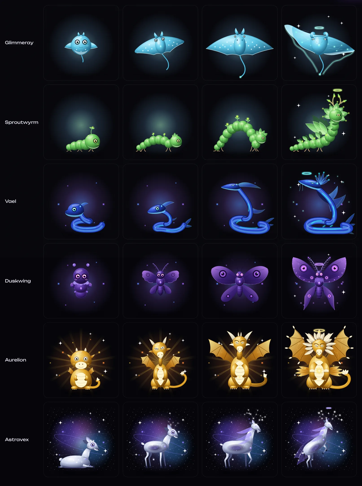
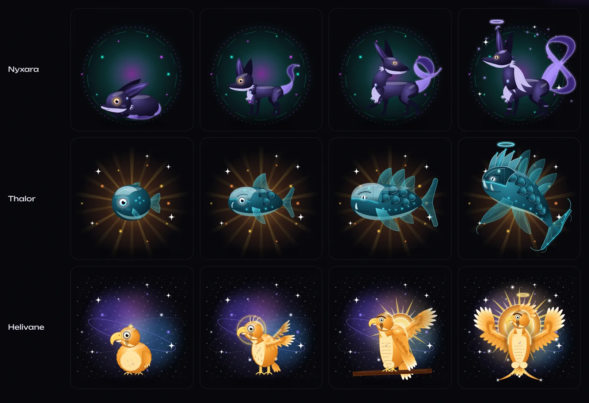
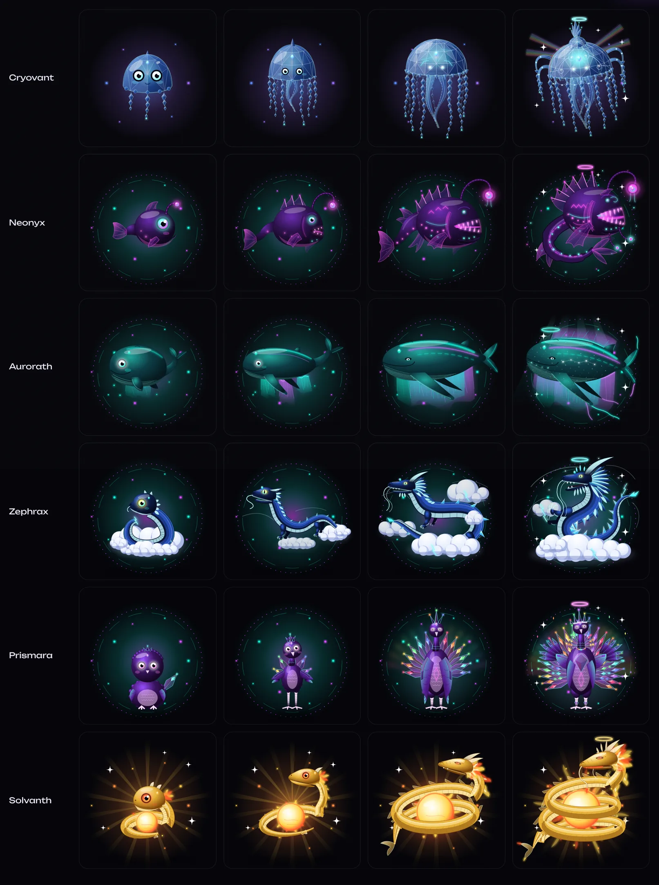
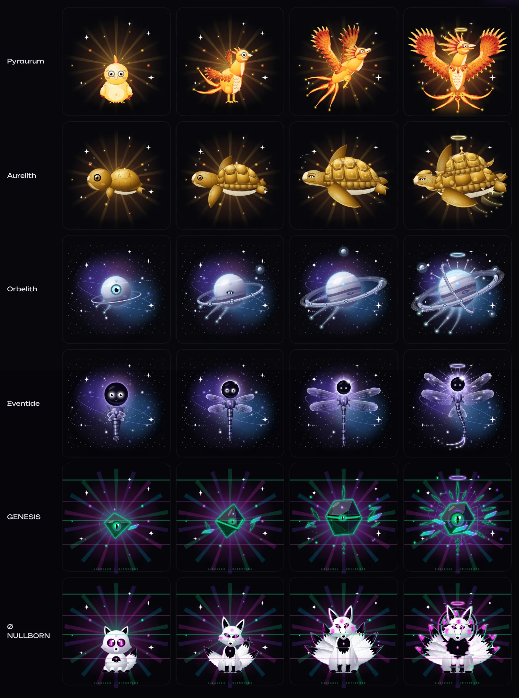

# Four-stage redesign: inventory and checklist

Every species is drawn as four separate vector forms (Eggling, Hatchling, Evolved, Ascended), using Velynx as the benchmark. The Evolved form is each species' existing mature drawing; the other three are new drawings with their own silhouette, pose and anatomy, not scaled or tweaked copies. Each drawing lives in `src/components/creature/species/<id>.tsx` and is selected per stage by `byStage()` in `kit.tsx`. A per-stage `stageFit` keeps each form framed.

This is procedural SVG art in the shared Solanites house style. It is not painted or rendered illustration. Raster assets can still replace any stage through `npm run art:build` (see `README.md`).

| # | Species | Id | Rarity | Element | Before | After | Batch |
|---|---|---|---|---|---|---|---|
| 1 | Mossling | mossling | Common | Verdant | 1 drawing, scaled | 4 drawings | 1 |
| 2 | Driftfin | driftfin | Common | Tidal | 1 drawing, scaled | 4 drawings | 1 |
| 3 | Pallow | pallow | Common | Lumen | 1 drawing, scaled | 4 drawings | 1 |
| 4 | Glimmeray | glimmeray | Common | Tidal | 1 drawing, scaled | 4 drawings | 2 |
| 5 | Sproutwyrm | sproutwyrm | Common | Verdant | 1 drawing, scaled | 4 drawings | 2 |
| 6 | Frostkit | frostkit | Common | Frost | 1 drawing, scaled | 4 drawings | 1 |
| 7 | Vael | abyssal-vael | Rare | Tidal | 1 drawing, scaled | 4 drawings | 2 |
| 8 | Stormquill | stormquill | Rare | Storm | 1 drawing, scaled | 4 drawings | 1 |
| 9 | Duskwing | duskwing | Rare | Shadow | 1 drawing, scaled | 4 drawings | 2 |
| 10 | Cryovant | cryovant | Rare | Crystal | 1 drawing, scaled | 4 drawings (Evolved redrawn) | 3 |
| 11 | Emberlisk | emberlisk | Rare | Ember | 1 drawing, scaled | 4 drawings | 1 |
| 12 | Neonyx | neonyx | Epic | Lumen | 1 drawing, scaled | 4 drawings (Evolved redrawn) | 3 |
| 13 | Aurorath | aurorath | Epic | Aether | 1 drawing, scaled | 4 drawings (Evolved redrawn) | 3 |
| 14 | Zephrax | zephrax | Epic | Storm | 1 drawing, scaled | 4 drawings (Evolved redrawn) | 3 |
| 15 | Prismara | prismara | Epic | Crystal | 1 drawing, scaled | 4 drawings (Evolved redrawn) | 3 |
| 16 | Aurelion | aurelion | Legendary | Solar | 1 drawing, scaled | 4 drawings | 2 |
| 17 | Solvanth | solvanth | Legendary | Solar | 1 drawing, scaled | 4 drawings (Evolved redrawn) | 3 |
| 18 | Pyraurum | pyraurum | Legendary | Ember | 1 drawing, scaled | 4 drawings (Evolved redrawn) | 4 |
| 19 | Aurelith | aurelith | Legendary | Solar | 1 drawing, scaled | 4 drawings (Evolved redrawn) | 4 |
| 20 | Astravex | astravex | Mythic | Nebula | 1 drawing, scaled | 4 drawings (Evolved redrawn too) | 2 |
| 21 | Orbelith | orbelith | Mythic | Aether | 1 drawing, scaled | 4 drawings (Evolved redrawn) | 4 |
| 22 | Eventide | eventide | Mythic | Void | 1 drawing, scaled | 4 drawings (Evolved redrawn) | 4 |
| 23 | GENESIS | genesis | Secret | Prism | 1 drawing, scaled | 4 drawings (Evolved redrawn) | 4 |
| 24 | Ø NULLBORN | nullborn | Secret | Void | 1 drawing, scaled | 4 drawings (Evolved redrawn) | 4 |
| 25 | Velynx | velynx | Legendary | Shadow | already 4 drawings (benchmark) | unchanged | — |
| 26 | Nyxara | nyxara | Epic | Shadow | new species | 4 drawings | new |
| 27 | Thalor | thalor | Legendary | Tidal | new species | 4 drawings | new |
| 28 | Helivane | helivane | Mythic | Solar | new species | 4 drawings | new |

## Batch 1: Mossling, Driftfin, Pallow, Frostkit, Stormquill, Emberlisk

- **Mossling:** moss-ball with one sprout → leafy calf with twig antlers → shingled forest beast → ancient guardian with a sapling on its back, root feet and a flowering antler crown.
- **Driftfin:** round tadpole → slim eel-fish with one fin → twin-sailed eel → sea dragon rising in an S-curl with crest, whiskers and fin veils.
- **Pallow:** down-fringed pearl with a sleepy eye → pearl ringed by seven first feathers → feather sunburst → seraph with tiered wing-fans, a plume crown and long glowing tassels.
- **Frostkit:** fluffy kit sitting facing forward → lean alert kit with first spines → crystal fox → regal ice fox with a crystal crown, mane, three crystal tails and frost breath.
- **Stormquill:** round chick with three quills → gangly juvenile on knobbly legs → stilt-legged crested heron → griffin-like storm bird with raised barred wings and a lightning crest.
- **Emberlisk:** chubby newt with ember spots → long salamander with its head raised → low armoured salamander → raised armoured titan with a molten crest, horned head and spiked tail club.

## Batch 2: Glimmeray, Sproutwyrm, Abyssal Vael, Duskwing, Aurelion, Astravex

- **Glimmeray:** round baby ray → banking juvenile → broad manta → gliding manta in an S-wave with light ribbons trailing from its wingtips.
- **Sproutwyrm:** plump grub with one sprout → low arching worm with buds → high-arched tulip-hooded inchworm → rearing leaf-winged wyrm with a blossom hood and a branching crown.
- **Abyssal Vael:** single coil with a big round head → low S-body with a half-grown crest → swan-necked coil → towering hooded serpent with a fanned crest crown and silk tail ribbons.
- **Duskwing:** fuzzy larva-moth → newly unfolded moth with soft wings → four-winged velvet moth → twilight sentinel with raised scalloped wings, eye-spots and trailing tails.
- **Aurelion:** plump baby dragon sitting up → young dragon with half-open wings → winged golden dragon → the Sovereign with a radiating mane, four wings and a five-horn crown.
- **Astravex:** folded fawn with star dapples → leggy fawn with first constellation antlers → proud stag mid-step with a nebula mane → rearing celestial stag with a starry veil and a full constellation crown.

## New species: Nyxara, Thalor, Helivane

- **Nyxara** (Epic, Shadow): curled indigo kit → gangly young fox → sleek fox mid-stride looking back with a looping ribbon tail → crescent-eared fox with twin ribbon tails in a figure-eight. A quadruped fox, deliberately unlike Velynx.
- **Thalor** (Legendary, Tidal): round armoured fry → sturdy juvenile with a helmet plate → broad-shielded guardian with layered fins → crowned Deepwarden surging upward with cathedral fins and a crescent tail. Heavy and armoured, unlike the slender Driftfin.
- **Helivane** (Mythic, Solar): amber eyas with an oversized beak → juvenile falcon with first flight feathers → perched raptor with a corona → wings raised around a blazing sun disc. Renamed from the requested "Solvane" because it was too close to the existing Solvanth. A raptor carrying a sun, not a phoenix. Classified until discovered, like the other Mythics.

## Batch 3: Cryovant, Neonyx, Aurorath, Zephrax, Prismara, Solvanth

- **Cryovant:** faceted crystal bud with big eyes → narrow bell with first shard tendrils → gem-cut jellyfish dome with long chains → crystal chandelier with a spire, sweeping arms and refraction rays.
- **Neonyx:** round baby fish with a tiny lure → toothy juvenile with a spined back → neon anglerfish with a lantern lure → regal lantern-wyrm with three lures, a towering frill and an S-coiled tail.
- **Aurorath:** round whale calf → lean calf with first aurora veils → sky whale trailing two aurora curtains → star-skinned whale rising through three curtains with an aurora crest.
- **Zephrax:** chubby serpent curled in a cloud puff → gangly young storm dragon on little clouds → long storm dragon looping through clouds → roaring dragon rising from a cloud bank with crystal spines and lightning.
- **Prismara:** downy chick with one prism shard → fledgling with a small shard fan → crystal peacock with a full shard fan → the Refractor Queen with a three-tier fan, raised wings and a jewelled crown.
- **Solvanth:** chubby gold serpent curled round an ember → leaner serpent round a sun-seed → leviathan coiled round a blazing sun → crowned serpent in rising coils with a corona of streamers.

## Batch 4: Pyraurum, Aurelith, Orbelith, Eventide, GENESIS, Ø NULLBORN

- **Pyraurum:** round golden chick with one flame feather → gangly fledgling with first fire plumes → phoenix climbing with raised flame wings → front-facing phoenix with huge flaming wings, a seven-plume crest and fire streamers.
- **Aurelith:** big-headed baby sea turtle → swimming juvenile with bevelled scutes → old gilded turtle with glowing inlay → rising turtle with a two-tier temple-roof shell and a molten gold trail.
- **Orbelith:** small orb with one big eye → banded orb with a segmented eyed coil and a moon → ringed platinum planet with two moons and comet tendrils → tilted world with a gyroscope of crossing coils, a corona and three moons.
- **Eventide:** plump nymph with a huge eclipse head → juvenile with unfolding wings and a half-formed eclipse → star-glass dragonfly with a full eclipse → galaxy-winged dragonfly with a blazing corona and comet-trail tail.
- **GENESIS:** inverted tetrahedron seed with one lens eye → tilted octahedron with a visor → icosahedron with a crown spike and shoulder shards → nested-cage core with shard wings and orbiting Solana bars.
- **Ø NULLBORN:** round white kit with void eyes → three-tailed juvenile → seven-tailed fox with an eerie head tilt → nine-tailed apex with a third eye, a void mane and heavy glitch slices.

## Completion checklist

- [x] All 28 species have four separately drawn stages (112 drawings). 13 Evolved forms were also redrawn where the old one was weak.
- [x] Three new species added: Nyxara (Epic), Thalor (Legendary), Helivane (Mythic; renamed from "Solvane" to avoid clashing with Solvanth).
- [x] Ids, names, rarities, elements, odds and discovery rules unchanged for existing species; Mythic and Secret species stay classified until discovered.
- [x] Each stage keeps exactly one Solgem and fits the 400×400 frame.
- [x] Typecheck, unit tests and production build pass.

## Honest limits

- This is procedural vector art in a shared house style, not painted illustration. It is consistent and animatable, but it does not have painterly texture, lighting or detail.
- Some reviewers' notes remain: a few Ascended forms are busy at thumbnail size (Orbelith, GENESIS, NULLBORN), Solvanth's coils can read as a spring, and Aurelith's upper roof tier can read as a second shell.
- NULLBORN's glitch effect redraws the figure several times, so its Ascended form costs more to render than the others.
- Raster art can still replace any stage through the art pipeline (`npm run art:build`) if painted assets are commissioned later.
