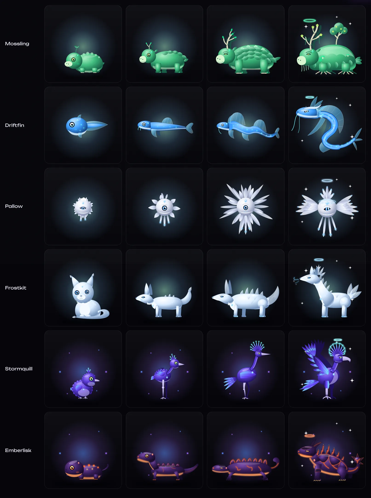

# Four-stage redesign: inventory and checklist

Every species is drawn as four separate vector forms (Eggling, Hatchling, Evolved, Ascended), using Velynx as the benchmark. The Evolved form is each species' existing mature drawing; the other three are new drawings with their own silhouette, pose and anatomy, not scaled or tweaked copies. Each drawing lives in `src/components/creature/species/<id>.tsx` and is selected per stage by `byStage()` in `kit.tsx`. A per-stage `stageFit` keeps each form framed.

This is procedural SVG art in the shared Solanites house style. It is not painted or rendered illustration. Raster assets can still replace any stage through `npm run art:build` (see `README.md`).

| # | Species | Id | Rarity | Element | Before | After | Batch |
|---|---|---|---|---|---|---|---|
| 1 | Mossling | mossling | Common | Verdant | 1 drawing, scaled | 4 drawings | 1 |
| 2 | Driftfin | driftfin | Common | Tidal | 1 drawing, scaled | 4 drawings | 1 |
| 3 | Pallow | pallow | Common | Lumen | 1 drawing, scaled | 4 drawings | 1 |
| 6 | Frostkit | frostkit | Common | Frost | 1 drawing, scaled | 4 drawings | 1 |
| 8 | Stormquill | stormquill | Rare | Storm | 1 drawing, scaled | 4 drawings | 1 |
| 11 | Emberlisk | emberlisk | Rare | Ember | 1 drawing, scaled | 4 drawings | 1 |

## Batch 1: Mossling, Driftfin, Pallow, Frostkit, Stormquill, Emberlisk

- **Mossling:** moss-ball with one sprout → leafy calf with twig antlers → shingled forest beast → ancient guardian with a sapling on its back, root feet and a flowering antler crown.
- **Driftfin:** round tadpole → slim eel-fish with one fin → twin-sailed eel → sea dragon rising in an S-curl with crest, whiskers and fin veils.
- **Pallow:** down-fringed pearl with a sleepy eye → pearl ringed by seven first feathers → feather sunburst → seraph with tiered wing-fans, a plume crown and long glowing tassels.
- **Frostkit:** fluffy kit sitting facing forward → lean alert kit with first spines → crystal fox → regal ice fox with a crystal crown, mane, three crystal tails and frost breath.
- **Stormquill:** round chick with three quills → gangly juvenile on knobbly legs → stilt-legged crested heron → griffin-like storm bird with raised barred wings and a lightning crest.
- **Emberlisk:** chubby newt with ember spots → long salamander with its head raised → low armoured salamander → raised armoured titan with a molten crest, horned head and spiked tail club.
