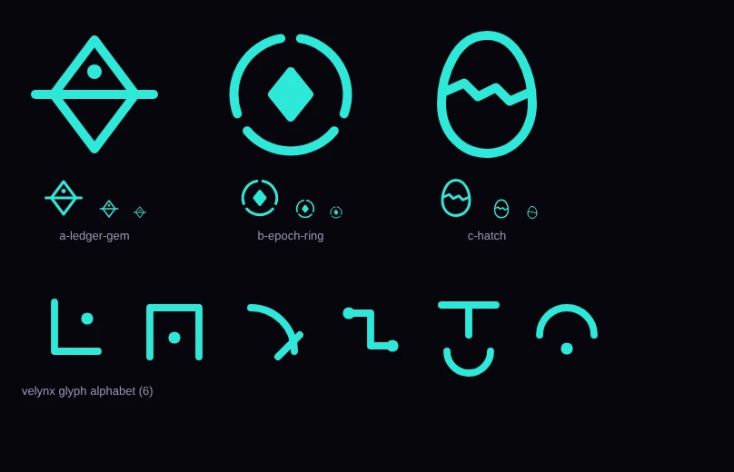

# Solanites glyph (decision 2)

An original mark to replace the Solana logo and Solana-style bars anywhere they appear on creatures. Drafted as plain SVG, which suits flat geometric marks like these (unlike the creature art). The colour is the Velynx/Shadow cyan only for the preview; the mark is single-colour and takes any element accent.

| Candidate | Idea | At 16 px | Notes |
|---|---|---|---|
| [A · Ledger Gem](mark-a-ledger-gem.svg) | the Solgem diamond cut by the block line, first light above it | weakest: dot and line merge | strong story, reads best large |
| [**B · Epoch Ring**](mark-b-epoch-ring.svg) | a small Solgem inside three epoch arcs | **clearest** | **recommended.** The three arcs also replace GENESIS's three orbiting bars, so the secret creature *is* the mark |
| [C · Hatch](mark-c-hatch.svg) | an egg split by a stepped crack | readable | ties to hatching, but the crack does not yet read as an "S" |

Design constraints for whichever is chosen: no parallel slanted bars (too close to the Solana mark), single colour, stroke-based so it can be drawn as glowing markings on a creature, survives at 16 px.

## Velynx glyph alphabet

[`velynx-glyphs.svg`](velynx-glyphs.svg): the six marks Velynx's body circuitry is built from (art direction in `prototypes/velynx.md` §4). They use only right angles, short arcs and dots on a 24-unit grid, so they read as an invented script and never as letters. Image prompts describe them in words; any generated glyphs that drift into pseudo-letters are painted over with these.
